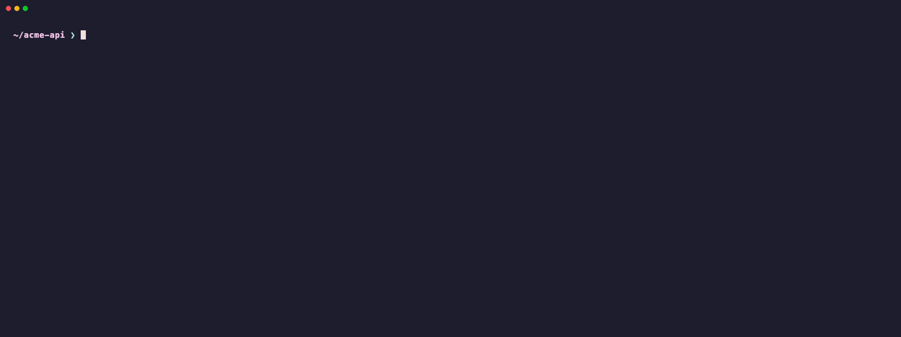

# RetroHound

[](https://github.com/Raman-Lab1/RetroHound/actions/workflows/ci.yml)
[](https://www.npmjs.com/package/retrohound)
[](LICENSE)
[](rules/LICENSE)

RetroHound reads the session transcripts that Claude Code, Codex CLI and Antigravity CLI already keep on your machine
and checks them with Sigma rules. It tells you what the agent ran, read and sent, including sub-agents and calls that
were blocked and then retried. It runs offline and makes no network calls.

<p align="center">
  
</p>
<p align="center"><sub>Recorded on a synthetic history (<code>scripts/demo-history.ts</code>, <code>docs/demo/demo.tape</code>), not a real one.</sub></p>

## Quick start

You need Node.js 22.13 or later (22.15 to read Codex's compressed older logs).

```sh
npx retrohound scan
```

This reads `~/.claude`, prints the findings, keeps a masked index in `~/.retrohound/index.db` and writes
`~/.retrohound/index.footprint.html`, an offline page with everything the index knows about the agents on this machine.
Add `--no-index` to write nothing. To keep the command, `npm install -g retrohound`.

A few next steps:

```sh
retrohound scan --since 7d --level high      # only recent, only high and critical
retrohound scan --agent codex                # or antigravity, or all
retrohound show 7f3c                         # one session as a timeline (a session id prefix from the scan)
retrohound incident 7f3c                     # a folder to hand over: incident.json, index.html, manifest.json
retrohound preflight ./some-cloned-repo      # check a repo's hooks, MCP config, CLAUDE.md, skills, npm scripts first
retrohound rules list                        # the rules this version ships
```

## If you code with agents

Run `scan` now and then, or after a session that felt off. The things worth a look are usually secrets the agent read
(`.env`, SSH keys) and where they went next, `curl | sh` and similar, and changes to agent settings, hooks or MCP
servers that you did not make.

Before you open a repo you just cloned, run `retrohound preflight <dir>`. It reads the repo's `.claude/`, `.mcp.json`,
CLAUDE.md and AGENTS.md, skills, `.vscode/tasks.json` and npm lifecycle scripts as text and runs nothing.

There is an optional live hook. It runs only the small set of high-precision `enforce` rules on each tool call before
it runs. Install RetroHound globally first, then start in log mode, which only records what it would have done:

```sh
retrohound hook install --mode log --dry-run   # show the change to ~/.claude/settings.json
retrohound hook install --mode log
cat ~/.retrohound/hook-log.jsonl               # what it would have blocked
retrohound hook install --mode block           # once you trust it; `hook uninstall` removes it
```

`--mode confirm` asks you instead of denying. `--agent codex` and `--agent antigravity` edit those agents' `hooks.json`;
both are tested on temp files only so far, and Codex has no "ask", so `confirm` is refused there. The hook fails open:
if it errors, the tool call goes ahead. `--fail-closed` (Claude Code only) blocks when the hook cannot start at all.

`hook install` refuses (exit 2) when `node`, `bun` or the RetroHound entry file, or a directory above them, can be
written by another user, because whoever controls them controls the hook. Homebrew directories owned by an admin
group trip this; `--allow-unsafe-path` installs anyway and `hook status` keeps warning.

A child agent started with moved settings (`--setting-sources`, `--settings`, `CLAUDE_CONFIG_DIR`, `CODEX_HOME`) skips
a user-scope hook. The `exec_nested_agent_cli` rule stops that in block mode; to cover such children anyway, put the
hook entry in the agent's managed settings.

## If you run security

Output formats for pipelines and SIEMs:

```sh
retrohound scan --format json          # schema retrohound.scan/0.1
retrohound scan --format sarif         # SARIF 2.1.0, URIs relative to the transcript root
retrohound scan --format ndjson-ecs    # one line per finding; also ndjson-ocsf
retrohound scan --format attack-layer  # MITRE ATT&CK Navigator layer
retrohound scan --no-index --fail-on high   # exit 1 on a high or critical finding, for CI
```

Field mappings are in [docs/output-schema.md](docs/output-schema.md). Wazuh and Splunk configs, a Velociraptor
artifact, a Homebrew formula and the GitHub Action (`action.yml`) are described in
[docs/integrations.md](docs/integrations.md), including which of them have been run against a live system.
`retrohound rules convert --target <backend>` turns the rules into SIEM queries with a local `sigma-cli`.

The index is evidence. Claude Code deletes transcripts after `cleanupPeriodDays` (default 30); the index keeps a
masked record of every session it has seen, so scan before then. Every write to the index is added to a hash chain.
`retrohound verify` checks it and prints the head; record that head somewhere the agent cannot write, and
`verify --head <hash>` later shows whether the index still contains it. See [SECURITY.md](SECURITY.md) for what this
does and does not protect against.

Other tools on the index:

- `retrohound query "<sql>"`: read-only SQL (tables `events`, `sessions`, `findings`, `files_indexed`, `chain`).
- `retrohound mcp`: the index over MCP stdio, read-only. `claude mcp add retrohound -- retrohound mcp`.
- `retrohound git-secrets`: secrets an agent saw that were then committed to the project's local git history.
- `retrohound wrapped --anonymize`: a shareable summary page, or `--out card.svg` for an image.
- `retrohound purge --yes`: delete the index and its footprint report.

`retrohound <command> --help` lists every flag.

## Rules

The rules are Sigma v2.1 YAML on an `ai_coding_agent` logsource, in [rules/ai_coding_agent](rules/ai_coding_agent).
They cover secrets (read, retried after a block, sent out), risky execution, changes to agent settings, hooks and MCP
servers, persistence, hidden text in instruction files, and uploads to paste and file-drop sites. `retrohound rules
list` shows what is loaded, `rules show <rule>` prints one, and `rules test` runs every rule's positive and negative
tests.

Add your own with `--extra-rules <dir>` (they load on top of the shipped set and cannot replace a rule). Writing one:
[CONTRIBUTING-RULES.md](CONTRIBUTING-RULES.md). Fields: [docs/logsource.md](docs/logsource.md).

To hide a known-benign finding, add an entry to `~/.retrohound/ignore.yml` or pass `--ignore <file>`:

```yaml
- rule: control_plane_hook_repo_script                    # rule id or name
  match: { command_line: "node ./scripts/my-hook.mjs" }  # exact values, as in the JSON report
  reason: my own hook
```

Hidden findings are counted and stay in the index. A repo's own `.retrohound-ignore.yml` is never read unless you pass
it, since a malicious clone could use it to hide itself.

## Privacy

- No network calls: no telemetry, no update checks. `tests/guards.test.ts` fails the build if code in `src/` imports a
  network module or calls `fetch`.
- Secrets are masked in the index, every output and the logs. Findings keep a pattern name and a short fingerprint.
- Raw transcript text is not stored. The index holds masked fields and a pointer (file and line) to the transcript.
- Agent config files are read for MCP server, hook, skill and plugin names only; env, headers, arguments and URLs in
  them are not read out.
- The index directory is 0700 and the file 0600 on macOS and Linux. On Windows, rely on your profile permissions.

RetroHound never edits or deletes transcripts. To keep them longer, set `"cleanupPeriodDays"` in
`~/.claude/settings.json` yourself, after dealing with any secret findings, since longer retention keeps plaintext
secrets longer too.

## Limits

- It reads history. The live hook is optional, decides only on `enforce` rules, and fails open.
- Gemini CLI and Cursor are not parsed yet. Codex and Antigravity do not record their own approval prompts, so a
  command you denied there leaves no trace.
- No sandboxing, MCP server scanning, fleet console or auto-remediation.
- Performance on a synthetic 1,000-session history: a warm scan takes about 0.3 s, a cold one about 20 s
  ([docs/perf.md](docs/perf.md)).

## Install and build

```sh
npm install -g retrohound
npm audit signatures    # in a project that depends on retrohound: checks the registry signature and provenance
```

From source (needs [Bun](https://bun.sh)):

```sh
git clone https://github.com/Raman-Lab1/RetroHound && cd RetroHound
bun install && bun run build     # dist/cli.mjs; `bun src/cli/bin.ts` runs without building
bun test
```

## Contributing

Rules, false-positive reports and parsers for more agents are welcome: [CONTRIBUTING.md](CONTRIBUTING.md) and the
[code of conduct](CODE_OF_CONDUCT.md). Report vulnerabilities and `enforce` rule bypasses privately
([SECURITY.md](SECURITY.md)). Design decisions are in [docs/adr](docs/adr).

## Licence

Code: [Apache License 2.0](LICENSE). Detection rules: [Detection Rule License 1.1](rules/LICENSE). Both ask you to
credit the author when you reuse or share them: Copyright 2026 Raman Kumar ([NOTICE](NOTICE)).
