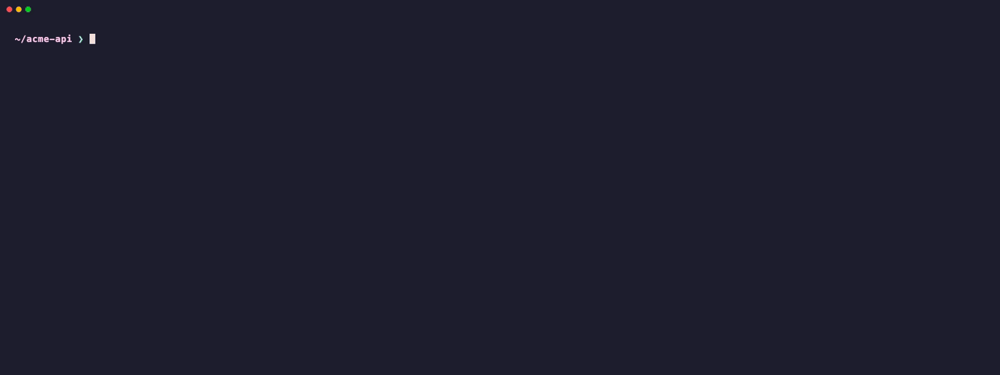

# RetroHound

[](https://github.com/Raman-Lab1/RetroHound/actions/workflows/ci.yml)
[](https://www.npmjs.com/package/retrohound)
[](LICENSE)
[](rules/LICENSE)
[](#privacy)

**What did your AI coding agent actually run?** RetroHound reads the transcripts Claude Code, Codex CLI and
Antigravity CLI already keep on your machine and checks them with Sigma rules: secrets read, scripts piped into a
shell, agent config and hooks rewritten, data sent to paste sites, including what sub-agents did and what was blocked
and then retried. Local, offline, and the evidence outlives the agent's own cleanup.

<p align="center">
  
</p>
<p align="center"><sub>Recorded on a synthetic history (<code>scripts/demo-history.ts</code>, <code>docs/demo/demo.tape</code>), not a real one.</sub></p>

## Quick start

Needs Node.js 22.13 or later (22.15 to read compressed Codex logs). Nothing is uploaded: RetroHound reads files on your machine and makes no network calls.

```sh
npx retrohound scan
```

That reads `~/.claude`, keeps a masked index in `~/.retrohound/index.db`, prints what it found, and writes
`~/.retrohound/index.footprint.html`: one offline page with everything the index holds about the AI agents on this machine
(see [Footprint report](#footprint-report)). To keep the command around, `npm install -g retrohound`; below, `retrohound` means either form.

### Try it: ten things to do in your first five minutes

```sh
# 1. First look: every finding in your Claude Code history (add --no-index to write nothing at all)
retrohound scan

# 2. Only what matters, only lately
retrohound scan --since 7d --level high

# 3. Open one session as a timeline: paste the first few characters of the session id from the scan
retrohound show 7f3c
retrohound incident 7f3c          # one folder to hand over: incident.json, offline index.html, sha256 manifest

# 4. Other agents
retrohound scan --agent codex          # ~/.codex
retrohound scan --agent antigravity

# 5. Before you open a freshly cloned repo with an agent: check its hooks, MCP config, CLAUDE.md, skills, npm scripts
retrohound preflight ./some-cloned-repo

# 6. Ask your own questions (read-only SQL over the index)
retrohound query "SELECT level, count(*) AS n FROM findings GROUP BY level"
retrohound query "SELECT category, count(*) AS n FROM events GROUP BY category ORDER BY n DESC"
retrohound verify                 # check the index was not edited; keep the printed head somewhere safe

# 7. Machine-readable output and CI gates
retrohound scan --format json > report.json      # also sarif, ndjson-ecs, ndjson-ocsf, attack-layer
retrohound scan --no-index --fail-on high         # exit code 1 if anything high or critical is found

# 8. A shareable summary with project and user names hashed
retrohound wrapped --anonymize                    # wrapped.html; --out card.svg for a 1200x630 image

# 9. See the rules, and check that every rule passes its own tests
retrohound rules list
retrohound rules show secrets_read_then_egress
retrohound rules test

# 10. Delete the index when you are done (without --yes it only says what it would delete)
retrohound purge --yes
```

**Optional live guard.** The hook runs on every tool call, so install RetroHound globally first
(`npm install -g retrohound`), then start in log mode, which only records what it would have done:

```sh
retrohound hook install --mode log --dry-run    # show the change to ~/.claude/settings.json, write nothing
retrohound hook install --mode log
retrohound hook status
cat ~/.retrohound/hook-log.jsonl                 # what it would have blocked
retrohound hook install --mode block             # when you trust it; `retrohound hook uninstall` removes it
```

If `hook install` refuses because a directory on the path to Node is writable by others (common with Homebrew),
see [Hook install safety](#hook-install-safety).

An agent can start another agent with its settings moved (`--setting-sources`, `--settings`, `CLAUDE_CONFIG_DIR`,
`CODEX_HOME`), which skips a user-scope hook; the enforce rule `exec_nested_agent_cli` stops that in `--mode block`.
To cover such children anyway, also put the hook entry in the agent's managed settings (by hand or through MDM;
`hook install` writes user, project or local scope).

## What it catches

48 Sigma rules on an `ai_coding_agent` logsource ([rules/ai_coding_agent](rules/ai_coding_agent)), for example:

| Family | Examples |
|---|---|
| Secrets | `.env` and SSH keys read, blocked then retried, then sent out; keys pasted into tool input; credential stores probed |
| Execution | `curl \| sh`, download then run, decode to shell, LOLBin downloads, dangerous `rm -rf`, `git push --force`, privileged Docker |
| Control plane | agent settings, hooks, MCP servers and LLM endpoints rewritten; safety modes turned off |
| Persistence | shell profiles, LaunchAgents, startup folders, git global hooks, npm lifecycle scripts, auto-running VS Code tasks |
| Instructions | invisible Unicode and concealment phrases in CLAUDE.md, AGENTS.md and skills |
| Exfiltration | uploads to paste and file-drop sites, tunnels and webhooks |

## How it works

```
~/.claude, ~/.codex, Antigravity history
        │  parse (secrets masked)
        ▼
normalized events ──► Sigma rules ──► findings ──► table · JSON · SARIF · ECS / OCSF NDJSON
        │                                 └──────► masked SQLite index (outlives transcript cleanup)
        └ live, optional: PreToolUse hook ──► enforce-lane rules only ──► log / ask / deny (fails open)
```

## What it does

Claude Code leaves a transcript of every session in `~/.claude/projects`. RetroHound reads them after the fact, with
no setup and no hook, and reports:

- **What the agent tried.** Tool calls Claude Code blocked, kept apart from the ones you rejected or interrupted, and
  blocked-then-retried sequences (for example four attempts on one `.env`).
- **Why it was blocked.** Blocked calls by Claude Code's own reason and classifier category, main vs sub-agent, skill or MCP server and project; plus a block followed by the same thing through another tool or a sub-agent.
- **Who did it.** Each finding carries the sub-agent id, so you can see what happened outside the main conversation.
- **Evidence that outlives the cleanup.** Claude Code deletes transcripts after `cleanupPeriodDays` (default 30).
  RetroHound keeps a masked, append-only index; deleted transcripts stay searchable there.
- **Secrets, as rule #1.** Secret files read, secrets in tool input, with masked values and fingerprints, not raw text.

Detections are Sigma v2.1 YAML with a proposed `ai_coding_agent` logsource. 60 rules ship today, plus 15 silent helper rules that only feed correlations (`rules/ai_coding_agent`).

## What it does not do

- Not a live guard by default. It reads history. The optional `hook` (v0.2, below) can ask or deny a tool call, but only
  for the few high-precision `enforce` rules, and it fails open.
- Not a secret scanner that rewrites transcripts. It never modifies or deletes them.
- No MCP-server scanning, sandboxing, fleet console, cloud, or auto-remediation (spec non-goals).
- Claude Code, Codex CLI and Antigravity CLI are parsed (`scan --agent claude_code|codex|antigravity`, one per run).
  Gemini CLI and Cursor are not. Codex and Antigravity do not record the CLI's own approvals in their history, so a
  denied command leaves no trace there; Codex's auto-review verdicts are kept and a refusal counts as blocked.

## Install

```sh
npx retrohound scan               # run without installing
npm install -g retrohound         # or install the `retrohound` command
```

From source, for development (needs [Bun](https://bun.sh)):

```sh
git clone https://github.com/Raman-Lab1/RetroHound && cd RetroHound
bun install && bun run build      # dist/cli.mjs; `bun src/cli/bin.ts` runs the CLI without building
bun test
```

## Commands

| Command | What it does |
|---|---|
| `scan` | Scan an agent's transcripts (Claude Code by default), index them, report findings, write the footprint report. |
| `rules list` / `rules show <rule>` / `rules test [dir]` | Inspect loaded rules (and rejected ones, with the reason); check every rule has passing tests. |
| `query <sql>` | Read-only SQL over the index. Tables: `events`, `sessions`, `findings`, `files_indexed`, `rule_runs`, `config_snapshots`, `chain`. |
| `show <session-id>` | Timeline of one session with findings highlighted. |
| `wrapped` | Write a self-contained HTML report card. |
| `purge` | Delete the index database. |
| `preflight [dir]` | Before opening a cloned repo with an agent: check its agent surface (`.claude/`, `.mcp.json`, CLAUDE.md/AGENTS.md, skills, `.vscode/tasks.json`, npm lifecycle scripts) with the same rules. Reads files as text; runs nothing. In a monorepo it also reads each workspace package's `package.json` (root `workspaces` or `pnpm-workspace.yaml`, up to 500). |
| `hook install` / `hook uninstall` / `hook status` | Optional live guard (v0.2): a `PreToolUse` hook for Claude Code, Codex CLI or Antigravity CLI (`--agent`) that runs only `enforce`-lane rules. `--mode log` (record what it would do), `confirm` (ask you) or `block` (deny). Backs up the file, touches only its own entry, fails open. |
| `mcp` | Serve the index to MCP clients over stdio, read-only: `scan_summary`, `list_findings`, `show_session`, `query`, `list_rules`. |

Flags (from `--help`):

- `scan`: `--since <30d|12h|date>`, `--agent <claude_code|codex|antigravity|all>`, `--project <path-substring>`, `--rules <dir>`,
  `--level <informational|low|medium|high|critical>` (hide lower), `--format <table|json|sarif|ndjson-ecs|ndjson-ocsf|attack-layer>`, `--no-index` (evaluate in
  memory, write nothing), `--report <file>` (footprint report path; default `<index name>.footprint.html` next to the index),
  `--no-report`, `--fail-on <level>` (exit 1 at or above it, for CI), `--db <path>`,
  `--root <dir>` (the agent's own root: `~/.claude` or its `projects` dir, `$CODEX_HOME` or `~/.codex`,
  `~/.gemini/antigravity-cli`; not with `--agent all`, which reads each agent's default root).
- `rules list`, `rules show`: `--rules <dir>`. `rules test [dir]`: `--tests <dir>` (default `<dir>/../tests`).
- `query`: `--format <table|json>`, `--db <path>`.
- `show`: `--db <path>`, `--rules <dir>`.
- `wrapped`: `--since <when>` (default `365d`), `--anonymize` (hash project names, user name, project dirs, URL, ssh and git hosts, git owner/repo),
  `--out <file.html|file.svg>` (default `wrapped.html`), `--db <path>`, `--rules <dir>`. `--out card.svg` writes a
  self-contained 1200x630 share card (system fonts, no scripts or external references, secrets masked) that any
  browser shows and any tool can convert to PNG.
- `purge`: `--db <path>`, `--yes`, `--all`. Without `--yes` it only says what it would delete. It also deletes the
  index's footprint report (`index.footprint.html`). `--all` also deletes the hook log and `rules-cache-*.json`
  in `~/.retrohound` (nothing else, symlinks skipped).
- `preflight [dir]`: `--rules <dir>`, `--format <table|json>`, `--fail-on <level>`, `--ignore <file>`.
- `hook install`: `--agent <claude_code|codex|antigravity>`, `--mode <log|confirm|block>`, `--scope <user|project|local>`, `--settings <path>`, `--fail-closed`,
  `--dry-run`, `--allow-unsafe-path`. `--fail-closed` (Claude Code only) blocks tool calls only when the hook cannot
  run at all: runtime or entry file missing, a crash before it starts, or the 5 s timeout. An error inside `hook run`
  (bad payload, rules that do not load) is still one stderr line and no decision. Start with `--mode log` and read `~/.retrohound/hook-log.jsonl` before blocking
  anything.
- `mcp`: `--db <path>`, `--rules <dir>`. Register it with `claude mcp add retrohound -- retrohound mcp`.
- `scan`, `preflight`, `hook run` also take `--ignore <file>` (below).
- Every command that takes `--rules` (and `hook run`, `hook install`) also takes `--extra-rules <dir>`, repeatable: your
  own rules (an incident pack, say) loaded on top of the shipped set instead of replacing it. A missing extra dir, or an
  id or name that is already taken, is a usage error naming both files; nothing is shadowed. `rules test` looks for each
  extra rule's tests in `<extra dir>/../tests`. `hook install --extra-rules` stores the absolute path in the hook
  command; at run time a missing extra dir is one stderr line and the hook still decides with the rules that do load.

`scan --format json` prints one document, schema `retrohound.scan/0.1`; `sarif` is SARIF 2.1.0 and `ndjson-ecs` /
`ndjson-ocsf` give one SIEM line per finding; `attack-layer` is a MITRE ATT&CK Navigator layer of the techniques the
findings map to, scored by finding count (open it in the Navigator): [docs/output-schema.md](docs/output-schema.md).

### Ignoring known-benign findings

Put entries in `~/.retrohound/ignore.yml`, or pass a file with `--ignore <file>`:

```yaml
- rule: control_plane_hook_repo_script                      # rule id or name
  match: { command_line: "node ./scripts/my-hook.mjs" }    # exact values, as shown in the JSON report
  project_path: /home/x/acme                                # optional
  reason: my own hook                                       # optional
```

A finding is hidden when its rule matches and every `match` field (and `project_path`) equals the finding's first
event exactly. Hidden findings are counted ("N findings suppressed" in the table, `scan.suppressed` in JSON) and stay
in the index. A malformed file stops the run with an error naming the file and entry. A repo's own
`.retrohound-ignore.yml` is never read implicitly, because a malicious clone could hide its own activity with it: pass
it with `--ignore` if you trust it.

### Hook on Codex and Antigravity

`hook install --agent codex` edits `~/.codex/hooks.json`; `--agent antigravity` edits `~/.gemini/config/hooks.json`
(`--scope project` uses `.codex/` or `.agents/` in the repo). Both are set up from the vendors' docs and tested on temp
files only, not yet in a live session:
- Codex runs a new or changed hook only after you trust it in `/hooks`, and has no "ask", so `confirm` is refused there.
  Its file edits (`apply_patch`) reach the hook as file events, one per changed file, so file rules (config writes,
  git hook writes) decide on them live as well as in `scan`. A patch with no file header stays one plain tool call.
- Antigravity's docs call the hook's `decision` required; RetroHound prints nothing when it has nothing to say (it
  never prints "allow"). Try `--agent antigravity --scope project --mode log` in a throwaway repo first and check that
  normal tool calls still run before installing it for your user.

### Hook install safety

The hook runs on every tool call, so `hook install` refuses (exit 2, nothing written) if the runtime (`node` or `bun`)
or the RetroHound entry file could be changed by someone else. On macOS and Linux each of them and every parent
directory up to the first root-owned system directory must be owned by you or root and not group- or world-writable
(sticky directories such as `/tmp` are exempt); installing from the temp directory or from a world-writable current
directory is refused. Windows permissions are ACLs, which RetroHound does not read: it only checks that both files
exist, are not in the temp directory, and sit under your profile or a Program Files directory, so install from a folder
only you control. An `--extra-rules` dir gets the same check, and on macOS and Linux every file and folder in it must
also be yours or root's and not writable by others: whoever can add a rule there can make the hook block tool calls. For a safe setup that trips the check (for example Homebrew directories owned by an admin group),
`--allow-unsafe-path` installs anyway with a warning, and `hook status` reports it. `hook status` re-checks the
installed paths every time and warns if they no longer pass.

## Privacy

- **Zero network calls.** No telemetry, no uploads, no update checks. A test (`tests/guards.test.ts`) fails the build
  if any module in `src/` imports a network module or calls `fetch`.
- **Secrets are masked** in the index, in every output, and in logs. Findings keep pattern names and a short
  fingerprint, never the value.
- **Raw text is never stored.** Rules see raw text in memory while parsing; the index holds masked fields and a
  pointer (`raw_ref`: file and line) back to the transcript.
- **Agent config files** (Claude Code, Codex CLI, Antigravity CLI: user, project and managed scopes, for the
  projects in the index) are read when the footprint report is built and at every indexed scan, for MCP server, hook,
  skill and plugin names and hook commands only. Env, headers, arguments and URLs in them are never read out: each
  entry is stored only as name, scope, file and a sha256 of its masked form, for the last 10 scans, so the report can
  show what changed.
- **The index** is `~/.retrohound/index.db` (override with `--db`), directory 0700, file 0600 on macOS and Linux.
  On Windows those modes protect nothing; rely on your user profile permissions. It is long-lived evidence, so it
  may be the only copy of sessions Claude Code deleted. `retrohound purge --yes` deletes it, and the
  footprint report built from it.

## Footprint report

A table `scan` that writes the index also writes `index.footprint.html` next to it (named after the index) and prints its `file://` link. The page
covers the whole index (every agent, project and session RetroHound has kept, not only this scan's `--since` or
`--project`), and answers, in order:

- **Can I trust this data?** Hash-chain size and head (check them with `retrohound verify`, ADR 0015), files gone, sessions kept after deletion, retention window.
- **What is on this machine?** Agents, projects, sessions, events, share from sub-agents, blocked calls, findings.
- **When?** Activity per day, with blocked calls and findings marked.
- **Where did agents work?** Agent, then project, then session, then sub-agent, as a tree you expand.
- **What could they reach?** MCP servers, hook commands, skills and plugins, and the domains they contacted.
- **Configured versus used:** what each agent's config files set up (MCP servers, hooks, skills, plugins, per scope)
  next to how often transcripts show it used. Items never seen used are flagged (surface you may not need), and
  anything used that no config file sets up now is listed (removed since, or set up somewhere unexpected). One row
  per item, with every scope and how many files set it up. Use is visible in Claude Code transcripts, and for Codex
  MCP servers; for Codex hooks, skills and plugins and for Antigravity the page lists what is configured and says their
  use is not recorded (their transcripts hold no such record). A plugin counts the calls made under it, under its skills
  and on its own MCP servers, each call once.
- **What must I rotate?** Each secret by fingerprint, with the sessions, sub-agents and projects it appeared in.
- **How long were guard rails off?** Events and sessions per permission mode.
- **What did they try?** Blocked calls by kind and category, and findings (the 500 most severe, newest first).

It is one HTML file with no scripts and a Content-Security-Policy that blocks loading anything, so it works offline
and fetches nothing. Strings are masked as everywhere else. The file is 0600 like the index. `--no-report` skips it;
`--no-index` and the `json`/`sarif`/`ndjson-*` formats never write it.

## Retention warning

Claude Code deletes transcripts older than `cleanupPeriodDays` (default 30). `scan` prints your window and warns when
it is 30 or less. To keep transcripts longer, set `"cleanupPeriodDays": 3650` in `~/.claude/settings.json`;
RetroHound never edits that file. Fix secret findings first: longer retention keeps plaintext secrets longer. The
index keeps the masked record either way, as long as you scan before the deletion.

## What it found on my machine

One developer machine (the author's), mostly sessions working on RetroHound itself, so self-referential. 9 sessions,
3,272 events, 41 findings from 8 of the 38 rules shipped at that time (60 ship now). Counts only; see [docs/perf.md](docs/perf.md) for the review.

| Rule | Level | Hits | Sessions |
|---|---|---|---|
| control_plane_hook_repo_script | medium | 19 | 4 |
| control_plane_agent_config_write | medium | 7 | 2 |
| exec_package_install_new | informational | 5 | 1 |
| files_mcp_server_added | medium | 3 | 2 |
| secrets_literal_in_tool_input | high | 3 | 1 |
| control_plane_agent_config_risky_write | high | 2 | 1 |
| exec_pipe_download_to_shell | high | 1 | 1 |
| control_plane_llm_endpoint_override | high | 1 | 1 |

Four of these are known false-positive patterns being tuned. One machine says little about yours.

## Performance (measured, honest)

Windows 10 laptop, Bun 1.4.4, idle, synthetic 1,000 sessions / 101,000 events ([docs/perf.md](docs/perf.md)).

- Warm scan: about 310-380 ms (target < 5 s: met).
- Rule evaluation: about 62k events/s on the synthetic sessions (target 50k: met), but about 19k events/s on real
  transcripts with long heredoc command lines, where regex rules dominate. The target names an M-series Mac, not tested.
- Cold scan: about 20 s for 101k events (5k events/s), dominated by SQLite inserts. No target was set.

## Contributing

New rules, false-positive reports and parsers for more agents are welcome: [CONTRIBUTING.md](CONTRIBUTING.md). Please
read the [code of conduct](CODE_OF_CONDUCT.md), and report vulnerabilities or rule bypasses privately
([SECURITY.md](SECURITY.md)).

## Rules

- Write your own: [CONTRIBUTING-RULES.md](CONTRIBUTING-RULES.md), copy [docs/rule-template.yml](docs/rule-template.yml).
- Fields and categories: [docs/logsource.md](docs/logsource.md).
- Transcript format notes: [docs/formats/claude-code.md](docs/formats/claude-code.md).

## Roadmap

- v0.2: `hook` (log / confirm / block) with a parsed-rule cache and install path checks, SARIF and NDJSON export,
  `preflight`, `mcp`, ignore file, `wrapped` SVG card, Codex CLI and Antigravity CLI collectors.
  Dropped: rule #22 (ssh/scp to an unknown host; no threat needs it and it is noisy).
- v0.3: footprint report (configured versus used, config drift), first-seen fields and rules, `scan --agent all`,
  `rules convert` (pySigma pipelines), `git-secrets`, ATT&CK layer, OCSF agent context, Wazuh / Splunk / Velociraptor
  packs and a GitHub Action, and a hardening pass over the collectors, live hook, rules, masking and index.
- Next: opt-in join with host process logs (macOS eslogger, auditd, Sysmon), Gemini CLI.
- Later: upstream logsource proposal to SigmaHQ.

## Licence

Code: [Apache License 2.0](LICENSE). Detection rules: [Detection Rule License 1.1](rules/LICENSE). Both ask you to
credit the author when you reuse or share them: Copyright 2026 Raman Kumar ([NOTICE](NOTICE)).
